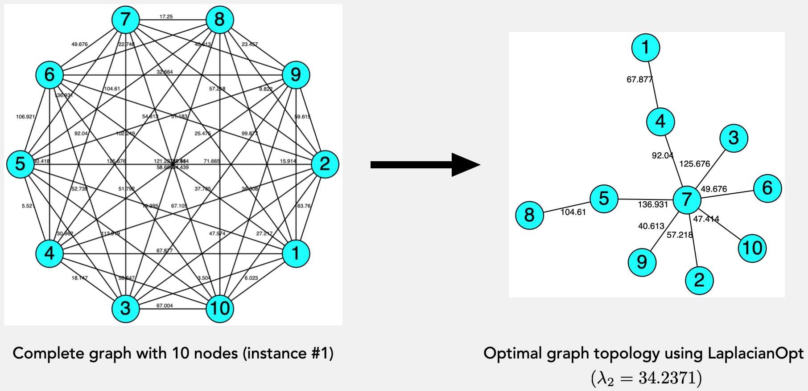

# Quick Start Guide

## Framework
Building on [Julia](https://julialang.org), [JuMP](https://github.com/jump-dev/JuMP.jl), and mixed-integer programming (MIP) solvers, [LaplacianOpt](https://github.com/harshangrjn/LaplacianOpt.jl) is an open-source toolkit for maximum algebraic connectivity augmentation on graphs. As illustrated below, LaplacianOpt is written in Julia, a fast programming language for technical computing with an extensible type system and metaprogramming support. At a high level, this package provides an abstraction layer to achieve two primary goals:
1. To capture user-specified inputs, such as the number of vertices of the graph, adjacency matrices of existing and augmentation graphs, and an augmentation budget, and to build a JuMP model of an MIP formulation with convex relaxations, and 
2. To extract, analyze and post-process the solution from the JuMP model and to provide optimal connected graphs with maximum algebraic connectivity.

```@raw html
<align="center"/>

```

## Getting started

After installing [LaplacianOpt](https://github.com/harshangrjn/LaplacianOpt.jl) and a MIP solver such as [Gurobi.jl](https://github.com/jump-dev/Gurobi.jl) or the open-source [GLPK](https://github.com/jump-dev/GLPK.jl), provide inputs based on the available graph data. LaplacianOpt accepts either JSON input or a data dictionary. The following example uses a data dictionary; see the example [script](https://github.com/harshangrjn/LaplacianOpt.jl/blob/master/examples/run_examples.jl) for JSON input.

```julia
import LaplacianOpt as LOpt
using JuMP
using Gurobi

function data()
    data_dict = Dict{String, Any}()
    data_dict["num_nodes"] = 4

    # Base graph with 3 existing edges (fixed). Note this graph can also be empty. 
    data_dict["adjacency_base_graph"] = [0 2 0 0; 2 0 3 0; 0 3 0 4; 0 0 4 0]

    # Augmentation graph with 3 candidate edges
    data_dict["adjacency_augment_graph"] = [0 0 4 8; 0 0 0 7; 4 0 0 0; 8 7 0 0]

    # Augmentation budget on candidate edges
    augment_budget = 2
    return data_dict, augment_budget
end

data_dict, augment_budget = data()

params = Dict{String, Any}(
    "data_dict"           => data_dict,
    "augment_budget"      => augment_budget
    )

lopt_optimizer = JuMP.optimizer_with_attributes(Gurobi.Optimizer, "presolve" => 1) 
results = LOpt.run_LOpt(params, lopt_optimizer)
```

!!! tip
    Run times of [LaplacianOpt](https://github.com/harshangrjn/LaplacianOpt.jl)'s mathematical optimization models are significantly faster using [Gurobi](https://www.gurobi.com) as the underlying mixed-integer programming (MIP) solver. Note that this solver's individual-usage license is available [free](https://www.gurobi.com/academia/academic-program-and-licenses/) for academic purposes. 

!!! tip
    [LaplacianOpt](https://github.com/harshangrjn/LaplacianOpt.jl) solves a combinatorial optimization problem that is known to be [NP-hard](https://doi.org/10.1016/j.orl.2008.09.001) in `num_nodes`. To obtain quick feasible solutions using k-opt-based heuristics, set `:solution_type` to `"heuristic"` in the model options and adjust `:num_swaps_bound_kopt`. A larger value can improve solution quality at the cost of increased heuristic runtime.

# Extracting results
For an optimal run, `run_LOpt` returns detailed results as a dictionary. For example, the runtime and optimal objective value (maximum algebraic connectivity) can be accessed with

```julia
results["solve_time"]
results["objective"]
```

The `"solution"` field contains detailed information about the solution produced by the optimization model. For example, the edges of the optimal graph topology can be obtained from the symmetric adjacency matrix with

```julia
optimal_graph = LOpt.optimal_graph_edges(results["solution"]["z_var"])
```
Further, algebraic connectivity and the Fiedler vector of the optimal graph topology (though can be applied on any graph topology) can be obtained from the adjacency matrix with,
```Julia
data = LOpt.get_data(params)
adjacency_matrix = data["adjacency_base_graph"] + data["adjacency_augment_graph"]
optimal_adjacency = results["solution"]["z_var"] .* adjacency_matrix 
graph_data = LOpt.GraphData(optimal_adjacency)
println("Algebraic connectivity: ", graph_data.ac)
println("Fiedler vector: ", graph_data.fiedler)
```

# Visualizing results
LaplacianOpt supports visualizing optimal graph layouts obtained from the `results` dictionary. Two options are available:
+ [TikzGraphs](https://github.com/JuliaTeX/TikzGraphs.jl) provides a simple graph layout with optional edge weights:

```julia
data = LOpt.get_data(params)
LOpt.visualize_solution(results, data, visualizing_tool = "tikz")
```

+ [Graphviz](https://graphviz.org) provides visualization of weighted graphs. LaplacianOpt generates a raw `.dot` file that can be rendered using a local [Graphviz installation](https://graphviz.org/download/) or an online frontend such as [Edotor](https://edotor.net):

```julia
data = LOpt.get_data(params)
LOpt.visualize_solution(results, data, visualizing_tool = "graphviz")
```
For example, for the weighted complete graph with 10 nodes in [instance #1](https://github.com/harshangrjn/LaplacianOpt.jl/blob/master/examples/instances/10_nodes/10_1.json), the optimal spanning tree with maximum algebraic connectivity, selected from ``10^8`` feasible solutions and visualized using Graphviz, is shown below.



