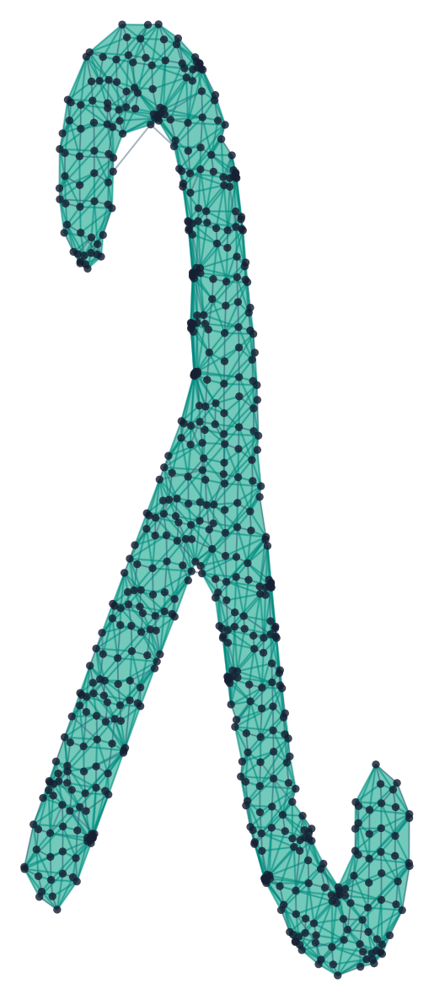
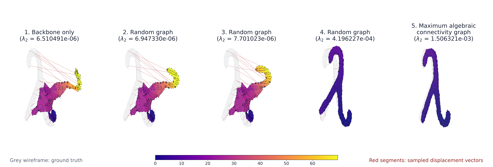

# Research & Publications

LaplacianOpt is developed alongside research on mathematical optimization
methods for maximizing graph algebraic connectivity and designing robust
networks.

## Graph sparsification for pose-graph SLAM

Pose-graph Simultaneous Localization and Mapping (SLAM) estimates a set of
unknown robot poses from noisy relative-pose measurements and is the standard
formulation in modern SLAM
([Cadena et al., 2016](https://doi.org/10.1109/TRO.2016.2624754)). Estimation
accuracy depends on both the precision of individual measurements and the
structure of the measurement graph: the Fisher information matrix of pose-graph
optimization is expressed in terms of weighted graph Laplacians
([Chen et al., 2021](https://doi.org/10.1109/TRO.2020.3001718)). For rotation
synchronization, the Cramér–Rao bound is governed by the pseudoinverse of the
weighted measurement-graph Laplacian, so increasing the algebraic connectivity
``\lambda_2`` lowers this bound
([Boumal et al., 2014](https://doi.org/10.1093/imaiai/iat006)). Sparse graphs
that keep ``\lambda_2`` bounded away from zero remain well suited to accurate estimation and 3D reconstruction.

That turns measurement selection into a graph-design problem. When sensing,
communication, or computation allow only ``K`` loop closures, which ``K``
should be kept? Given a fixed spanning-tree backbone and a pool of candidate
loop closures weighted by their measurement precision, LaplacianOpt selects the
``K`` loop closures that maximize ``\lambda_2`` of the resulting graph, either
to global optimality or quickly with heuristics. Because ``\lambda_2`` is small
whenever part of the graph hangs on by only a few weak edges, maximizing it
spends the budget on loop closures that brace weakly constrained regions, not
on redundant measurements where the graph is already rigid.

### Example: recovering a 3D surface

The ground truth is a three-dimensional ``\lambda``-shaped surface. It is used
only to generate the noisy measurements and to score the final reconstruction;
neither the edge selection nor the estimator ever sees it. Every selection
receives the same backbone, the same pool of candidate loop closures with their
uncertainties, the same noisy measurements, and the same budget. Each selected
graph is then solved with a standard nonlinear pose-graph estimator. The better
connected the selected graph, the closer its reconstruction stays to the
ground truth.

```@raw html
<figure class="posegraph-research-figure posegraph-ground-truth-figure">
```
[](assets/posegraph_ground_truth.png)
```@raw html
  <figcaption>
    Ground-truth lattice with 616 surface poses, 615 fixed backbone edges, and
    1,298 candidate loop closures. It is used only to generate noisy
    measurements and evaluate the reconstructions.
  </figcaption>
</figure>
```

```@raw html
<figure class="posegraph-research-figure">
```
[](assets/posegraph_algebraic_connectivity.png)
```@raw html
  <figcaption>
    Sparse pose-graph reconstructions from a fixed backbone and a 20%
    loop-closure budget (260 of 1,298 candidate loop closures), ordered by
    increasing algebraic connectivity. The grey wireframe is the ground truth,
    surface colour shows per-pose translation error, and red segments show
    sampled displacement vectors. Poorly placed loop closures barely improve
    on the backbone-only estimate, while the maximum-algebraic-connectivity
    selection recovers the geometry with substantially lower error.
  </figcaption>
</figure>
```

## Publications

Select a publication to read a short overview and follow its paper links or
copy its BibTeX citation. If you find LaplacianOpt useful, we request that you
cite the papers most relevant to your work.

```@raw html
<section class="publication-timeline" aria-label="LaplacianOpt publication timeline">
  <details class="publication-card">
    <summary>
      <span class="publication-year">2024</span>
      <span class="publication-heading">
        <span class="publication-title">Optimal Robust Network Design: Formulations and Algorithms for Maximizing Algebraic Connectivity</span>
        <span class="publication-venue">IEEE Transactions on Control of Network Systems</span>
      </span>
    </summary>
    <div class="publication-body">
      <p class="publication-authors">Neelkamal Somisetty, Harsha Nagarajan, and Swaroop Darbha</p>
      <p>
        This work develops exact and scalable optimization methods for designing
        edge-weighted networks with maximum algebraic connectivity. It presents
        mixed-integer semidefinite and linear formulations, principal-minor
        upper bounds, degree-constrained lower bounds, and a maximum-cost
        heuristic for larger networks.
      </p>
      <nav class="publication-links" aria-label="Links for the TCNS 2024 publication">
        <a href="https://doi.org/10.1109/TCNS.2024.3431408">IEEE</a>
        <a href="https://arxiv.org/abs/2304.08571">arXiv</a>
      </nav>
      <div class="citation-block">
        <div class="citation-header">
          <span>BibTeX</span>
          <button type="button" class="bibtex-copy" aria-label="Copy the TCNS 2024 BibTeX citation">Copy BibTeX</button>
        </div>
        <pre><code class="language-bibtex">@article{LOpt_TCNS2024,
  title={Optimal Robust Network Design: Formulations and Algorithms for Maximizing Algebraic Connectivity},
  author={Somisetty, Neelkamal and Nagarajan, Harsha and Darbha, Swaroop},
  journal={IEEE Transactions on Control of Network Systems},
  pages={918--929},
  volume={12},
  number={1},
  year={2024},
  doi={10.1109/TCNS.2024.3431408},
  publisher={IEEE}
}</code></pre>
      </div>
    </div>
  </details>

  <details class="publication-card">
    <summary>
      <span class="publication-year">2024</span>
      <span class="publication-heading">
        <span class="publication-title">Spectral Graph Theoretic Methods for Enhancing Network Robustness in Robot Localization</span>
        <span class="publication-venue">63rd IEEE Conference on Decision and Control (CDC)</span>
      </span>
    </summary>
    <div class="publication-body">
      <p class="publication-authors">Neelkamal Somisetty, Harsha Nagarajan, and Swaroop Darbha</p>
      <p>
        Motivated by cooperative robot localization and pose-graph
        sparsification, this paper strengthens algebraic-connectivity models
        with Cheeger cuts. It develops a mixed-integer linear formulation for
        computing Cheeger constants, incorporates the cuts into an
        outer-approximation algorithm, and introduces a greedy k-opt heuristic.
      </p>
      <nav class="publication-links" aria-label="Links for the CDC 2024 publication">
        <a href="https://doi.org/10.1109/CDC56724.2024.10886863">IEEE</a>
        <a href="https://arxiv.org/abs/2409.15506">arXiv</a>
      </nav>
      <div class="citation-block">
        <div class="citation-header">
          <span>BibTeX</span>
          <button type="button" class="bibtex-copy" aria-label="Copy the CDC 2024 BibTeX citation">Copy BibTeX</button>
        </div>
        <pre><code class="language-bibtex">@inproceedings{LOpt_CDC2024,
  title={Spectral Graph Theoretic Methods for Enhancing Network Robustness in Robot Localization},
  author={Somisetty, Neelkamal and Nagarajan, Harsha and Darbha, Swaroop},
  booktitle={IEEE 63rd Conference on Decision and Control (CDC)},
  pages={8811--8818},
  year={2024},
  doi={10.1109/CDC56724.2024.10886863},
  organization={IEEE}
}</code></pre>
      </div>
    </div>
  </details>

  <details class="publication-card">
    <summary>
      <span class="publication-year">2015</span>
      <span class="publication-heading">
        <span class="publication-title">On Maximizing Algebraic Connectivity of Networks for Various Engineering Applications</span>
        <span class="publication-venue">European Control Conference (ECC)</span>
      </span>
    </summary>
    <div class="publication-body">
      <p class="publication-authors">Harsha Nagarajan, Sivakumar Rathinam, and Swaroop Darbha</p>
      <p>
        This paper studies algebraic connectivity as a robustness objective for
        mechanical systems, vehicle localization, UAV formations, and
        communication networks. It also develops a Fiedler-vector-based
        mixed-integer linear formulation and cutting-plane methods for finding
        optimal solutions and upper bounds.
      </p>
      <nav class="publication-links" aria-label="Links for the ECC 2015 publication">
        <a href="https://doi.org/10.1109/ECC.2015.7330770">IEEE</a>
      </nav>
      <div class="citation-block">
        <div class="citation-header">
          <span>BibTeX</span>
          <button type="button" class="bibtex-copy" aria-label="Copy the ECC 2015 BibTeX citation">Copy BibTeX</button>
        </div>
        <pre><code class="language-bibtex">@inproceedings{LOpt_ECC2015,
  title={On Maximizing Algebraic Connectivity of Networks for Various Engineering Applications},
  author={Nagarajan, Harsha and Rathinam, Sivakumar and Darbha, Swaroop},
  booktitle={European Control Conference (ECC)},
  pages={1626--1632},
  year={2015},
  doi={10.1109/ECC.2015.7330770},
  organization={IEEE}
}</code></pre>
      </div>
    </div>
  </details>
</section>
```
